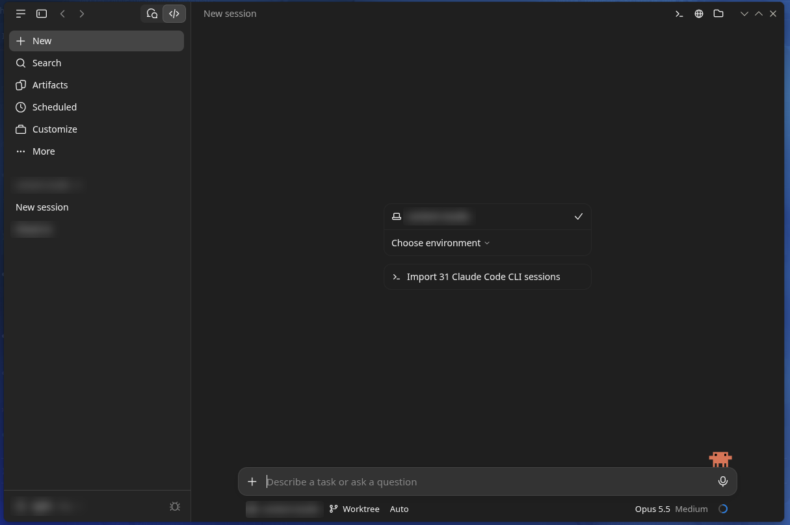
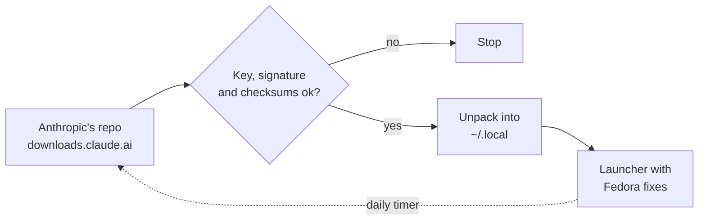
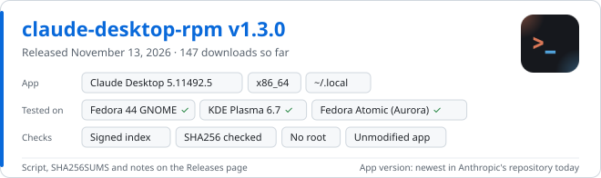
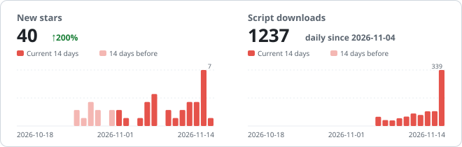

<div align="center">



<br />

<a href="https://fedoramagazine.org/installing-the-official-claude-desktop-linux-beta-on-fedora-linux/"></a>

[](https://github.com/ajithakdev/claude-desktop-rpm/actions/workflows/ci.yml)
[](https://github.com/ajithakdev/claude-desktop-rpm/releases/latest)
[](https://github.com/ajithakdev/claude-desktop-rpm/releases)
[](https://fedoraproject.org)
[](LICENSE)
[](https://github.com/ajithakdev)

**[Install](#install)** · **[Features](#features)** · **[Commands](#commands)** · **[What it changes](#what-it-changes-on-your-system)** · **[How it works](#how-it-works)** · **[FAQ](#faq)** · **[Guide](RESOURCES-AND-GUIDE.md)**

</div>

<br />

Anthropic publishes Claude Desktop for Linux as a `.deb` in its own APT repository. Fedora can't install that directly, so this script does what APT would: it fetches the signed repository index from `downloads.claude.ai`, verifies it against Anthropic's pinned key, checks the package checksum, and unpacks the package into `~/.local`. It needs no root, adds no third-party repository and doesn't repackage anything. It then adds the small pieces that Fedora needs and the `.deb` doesn't ship: a launcher, desktop integration, a daily update timer and a one-command Cowork setup.

> [!NOTE]
> Claude Desktop is Anthropic's proprietary app. Chat works on every plan, including Free; Claude Code and Cowork need a paid plan (Pro, Max, Ultra, Team or Enterprise). Details are in Anthropic's [download FAQ](https://claude.com/download) and [plan table](https://support.claude.com/en/articles/10065433-install-claude-desktop). This script is MIT licensed, isn't made by Anthropic, and doesn't redistribute any of its files.



## Install

```bash
sudo dnf install curl gnupg2 binutils tar
curl -fLO https://github.com/ajithakdev/claude-desktop-rpm/releases/latest/download/claude-desktop-rpm.sh
chmod +x claude-desktop-rpm.sh && ./claude-desktop-rpm.sh install
```

Run it as your normal user; it refuses to run as root. Open **Claude** from the app menu and sign in. The script copies itself to `~/.local/bin/claude-desktop-rpm`, so every later command works from any folder.

For Cowork, run `claude-desktop-rpm cowork` once (it asks for sudo), then log out and back in. If something looks off, run `claude-desktop-rpm doctor`; every warning comes with its fix.

Tested on Fedora 44 Workstation (GNOME, x86_64). Reported working on KDE Plasma and Fedora Atomic ([#2](https://github.com/ajithakdev/claude-desktop-rpm/issues/2)). On aarch64 the script fetches Anthropic's arm64 package; test reports are welcome.

<details>
<summary><b>Screenshot</b> (Fedora 44 GNOME, dark mode)</summary>

<p align="center"></p>

</details>

## Features

<table>
  <tr>
    <td width="50%" valign="top">&nbsp; <b>Verified before it's unpacked</b><br /><sub>Pinned key fingerprint, a good signature from that key, an unexpired index, and SHA256 of the package list and the <code>.deb</code>. Any mismatch stops the install.</sub></td>
    <td width="50%" valign="top">&nbsp; <b>No root to install</b><br /><sub>Everything lives under <code>~/.local</code> and <code>~/.config</code>. <code>uninstall</code> removes it and keeps your chats and sign-in.</sub></td>
  </tr>
  <tr>
    <td valign="top">&nbsp; <b>Fixes in the launcher, not the app</b><br /><sub>Dark mode, the tray icon, GNOME search and the app menu. Anthropic's files stay exactly as shipped.</sub></td>
    <td valign="top">&nbsp; <b>Daily updates</b><br /><sub>A systemd user timer runs the same verified install. If Claude is open, the update is staged and applied on the next launch.</sub></td>
  </tr>
  <tr>
    <td valign="top">&nbsp; <b>Cowork in one command</b><br /><sub>Installs QEMU, OVMF and virtiofsd from Fedora's repos, loads <code>vhost_vsock</code> at boot and adds you to the <code>kvm</code> group.</sub></td>
    <td valign="top">&nbsp; <b>Profiles</b><br /><sub><code>profile add work</code> adds a "Claude (work)" menu entry with its own sign-in and chats, open next to your default one.</sub></td>
  </tr>
  <tr>
    <td valign="top">&nbsp; <b><code>doctor</code></b><br /><sub>Checks the app, the desktop integration and every Cowork prerequisite, and prints the fix for each failure.</sub></td>
    <td valign="top">&nbsp; <b>Tested on every pull request</b><br /><sub>ShellCheck, attacks against a tampered fake repository, a real install, and a fresh Fedora 44 container from install to uninstall.</sub></td>
  </tr>
</table>

## Commands

| Command | What it does |
| --- | --- |
| `install`, `update` | Install the newest version. Does nothing if you're current. |
| `update --force` | Reinstall the current version, or accept an older one. |
| `auto-update on`, `off` | Turn the daily update check on or off. No argument shows its state. |
| `doctor` | Check everything and print fixes. |
| `cowork` | Set up Cowork (uses sudo). |
| `profile add NAME`, `remove NAME` | A second account, open side by side: adds "Claude (NAME)" to the app menu with its own sign-in and chats. `profile` alone lists them. |
| `self-update` | Replace the script with the latest release, after checking it against that release's `SHA256SUMS`. The daily timer updates the app, not the script. |
| `version` | Print the installed version. |
| `uninstall` | Remove everything it added. Chats and sign-in stay. |

## What it changes on your system

| Area | What happens |
| :---: | --- |
| <br />Files | Only `~/.local` and `~/.config`; every path is in the [guide](RESOURCES-AND-GUIDE.md#files-it-writes). `uninstall` removes them and rebuilds the menu, file-type and icon caches. Your chats and sign-in in `~/.config/Claude` stay. |
| <br />Network | The script only talks to `downloads.claude.ai`, plus this repo's GitHub releases when you run `self-update`. Redirects away from HTTPS are refused. The app itself talks to Anthropic's servers, as on every platform. |
| <br />Root | `install`, `update` and `uninstall` never use sudo. `cowork` does, to install `qemu-system-x86-core`, `edk2-ovmf` and `virtiofsd` from Fedora's repos, write `/etc/modules-load.d/vhost_vsock.conf`, load `vhost_vsock` and add you to the `kvm` group. It never changes a file a package owns, so `rpm -V` stays clean. |
| <br />Updates | A systemd user timer (`claude-desktop-rpm-update.timer`) checks once a day. If Claude is open, the verified update waits and goes in the next time you start it. `auto-update off` stops it. |
| <br />Profiles | `profile add work` writes one menu entry. The launcher starts that entry with Chromium's own `--user-data-dir` flag, so its data lives in `~/.config/Claude-work`. The app files stay untouched. Anthropic doesn't officially support other data folders, so a future version could ignore the flag; your default profile is never affected. Each open profile gets its own tray icon, and they look the same (the icon is the app's own file, which we don't change); the tray menu shows each account's plan. |
| <br />Tested | `tests/sandbox.sh` checks all of this in a fresh Fedora 44 container on every pull request. |

## How it works



1. Download Anthropic's signing key and the repository index (`InRelease`) from `downloads.claude.ai`.
2. Check the key's fingerprint against the one pinned in the script, check that the index carries a good signature from that key, and check its `Valid-Until` date.
3. Download the package list, compare its SHA256 with the index, and read the newest version from it. The package path must look like Anthropic's, and a version older than the installed one is refused unless you pass `--force`.
4. Download the `.deb` and compare its SHA256 with the package list.
5. Unpack it with `ar` and `tar` into a new folder, then swap it in place of the old one. Write the launcher, desktop entry, icons and GNOME search provider.
6. The daily timer runs steps 1 to 5 again.

Any failed check stops the run before anything is installed. [SECURITY.md](SECURITY.md) covers the threat model, and `tests/mock-repo.sh` has a tampered-repository case for every check.

## Why this one

| | claude-desktop-rpm | Third-party dnf repos | Build-your-own RPM scripts |
| --- | --- | --- | --- |
| Who you trust | Anthropic only | Anthropic and the repo owner's key | Anthropic and the build script |
| App files | Unmodified | Some patch the app | Unmodified or patched |
| Needs root to install | No | Yes | Yes |
| Updates | Daily, automatic | With `dnf upgrade` | Re-run the build |

Pick this one if you want Anthropic's exact build with no extra signing key on your system. Other good options: [claude-desktop-debian](https://github.com/aaddrick/claude-desktop-debian) (APT and DNF repos), [claude-desktop-fedora](https://github.com/dewzor/claude-desktop-fedora) (native RPM with Copr updates) and [claude-desktop-linux-flake](https://github.com/k3d3/claude-desktop-linux-flake) (Nix).

## FAQ

<details>
<summary><b>Is this official?</b></summary>
<br />
No. The app is Anthropic's official Linux build; the installer is a community project, not affiliated with Anthropic. Anthropic supports only Debian and Ubuntu for now and <a href="https://code.claude.com/docs/en/desktop-linux">says other distributions are coming</a>.
</details>

<details>
<summary><b>Why isn't it an <code>.rpm</code> file?</b></summary>
<br />
An RPM would need root to install and a signing key you'd have to trust. Unpacking Anthropic's package into your home folder avoids both. The name says what it's for: RPM-based systems.
</details>

<details>
<summary><b>What doesn't work?</b></summary>
<br />
Computer Use, which Anthropic's Linux build doesn't have yet on any distribution. Dictation works (tested in 3.6556.2, chat and Code tabs). RHEL, Rocky and Alma probably work, and reports are welcome.
</details>

<details>
<summary><b>Something looks wrong.</b></summary>
<br />
Run <code>claude-desktop-rpm doctor</code>. The <a href="RESOURCES-AND-GUIDE.md#when-something-goes-wrong">guide</a> covers the rest, such as the app's "Update available" button, a light System theme, or "Hardware acceleration disabled" after a reboot.
</details>

## Contributing

Bug reports, test reports from other desktops and fixes are welcome. [CONTRIBUTING](.github/CONTRIBUTING.md) has the setup and the four test scripts, and there are [good first issues](https://github.com/ajithakdev/claude-desktop-rpm/labels/good%20first%20issue): test it on your desktop ([#15](https://github.com/ajithakdev/claude-desktop-rpm/issues/15)) or add tab completion ([#16](https://github.com/ajithakdev/claude-desktop-rpm/issues/16)). Questions go to [Discussions](https://github.com/ajithakdev/claude-desktop-rpm/discussions).

## Releases and downloads

<p>
<a href="https://github.com/ajithakdev/claude-desktop-rpm/releases/latest"><picture><source media="(prefers-color-scheme: dark)" srcset="https://raw.githubusercontent.com/ajithakdev/claude-desktop-rpm/stats/release-dark.svg" /></picture></a>
<a href="https://github.com/ajithakdev/claude-desktop-rpm/releases"><picture><source media="(prefers-color-scheme: dark)" srcset="https://raw.githubusercontent.com/ajithakdev/claude-desktop-rpm/stats/stats-dark.svg" /></picture></a>
</p>

Downloads count the script itself, per release; GitHub doesn't keep a daily history. Updates come from Anthropic's repository, not this script, so this is close to the number of installs. Both cards are redrawn daily.

## Credits

Maintained by [ajithakdev](https://github.com/ajithakdev). Written with help from Claude, Anthropic's AI assistant, which drafted much of the script, tests and docs; every change is reviewed and tested before release.

These people found bugs, tested on other desktops or reviewed the project, and it is better for it. Fedora names link to their [Fedora Discussion](https://discussion.fedoraproject.org) profiles, where the [article review](https://discussion.fedoraproject.org/t/205949) and the [script thread](https://discussion.fedoraproject.org/t/205947) happened.

<table>
  <tr>
    <td align="center" valign="top" width="150"><a href="https://github.com/aurora"></a><br /><a href="https://github.com/aurora"><sub><b>Harald Lapp</b></sub></a><br /><sub>KDE Plasma test <a href="https://github.com/ajithakdev/claude-desktop-rpm/issues/2">#2</a></sub></td>
    <td align="center" valign="top" width="150"><a href="https://discussion.fedoraproject.org/u/thephatlee"></a><br /><a href="https://discussion.fedoraproject.org/u/thephatlee"><sub><b>Marko Jokinen</b></sub></a><br /><sub>Signature check <a href="https://github.com/ajithakdev/claude-desktop-rpm/issues/7">#7</a></sub></td>
    <td align="center" valign="top" width="150"><a href="https://discussion.fedoraproject.org/u/glb"></a><br /><a href="https://discussion.fedoraproject.org/u/glb"><sub><b>Gregory Lee Bartholomew</b></sub></a><br /><sub>Magazine review <a href="https://github.com/ajithakdev/claude-desktop-rpm/issues/8">#8</a> <a href="https://github.com/ajithakdev/claude-desktop-rpm/issues/9">#9</a></sub></td>
    <td align="center" valign="top" width="150"><a href="https://discussion.fedoraproject.org/u/rlengland"></a><br /><a href="https://discussion.fedoraproject.org/u/rlengland"><sub><b>Richard England</b></sub></a><br /><sub>Magazine review <a href="https://github.com/ajithakdev/claude-desktop-rpm/issues/8">#8</a> <a href="https://github.com/ajithakdev/claude-desktop-rpm/issues/9">#9</a></sub></td>
    <td align="center" valign="top" width="150"><a href="https://discussion.fedoraproject.org/u/jflory7"></a><br /><a href="https://discussion.fedoraproject.org/u/jflory7"><sub><b>Justin Wheeler</b></sub></a><br /><sub>Magazine review <a href="https://github.com/ajithakdev/claude-desktop-rpm/issues/8">#8</a> <a href="https://github.com/ajithakdev/claude-desktop-rpm/issues/9">#9</a></sub></td>
  </tr>
</table>

Thanks also to the free services this project runs on: [GitHub](https://github.com) for hosting, CI and releases, [Shields.io](https://shields.io) for the badges, and [Fedora Discussion](https://discussion.fedoraproject.org) for the place to ask.

## More from me

<details>
<summary>Other things I build</summary>

| Project | What it is |
| --- | --- |
| [Toolglass](https://toolglass.ajithakdev.com) ([repo](https://github.com/ajithakdev/toolglass)) | 41 free tools that run in your browser: image compressor, screen recorder, JSON, JWT, regex and more. Works offline, no tracking. |
| [MeterX](https://meterx.ajithakdev.com) ([repo](https://github.com/ajithakdev/meterx)) | A speed test in your browser toolbar: download, upload, ping, jitter and packet loss. |
| [Minnoli](https://minnoli.ajithakdev.com) | All the Tamil Nadu electricity bills you look after on one screen, sorted by due date, in Tamil and English. |
| [amazon-pincode-checker](https://github.com/ajithakdev/amazon-pincode-checker) | Checks whether an Amazon.in product delivers to a list of Indian pincodes. |
| [clip-paste](https://github.com/ajithakdev/clip-paste) | A clipboard manager for the COSMIC desktop that pastes straight into your window. |
| [CNoBS](https://github.com/ajithakdev/CNoBS) | Learn C in 20-minute chunks: see the output, guess, then break it. |

More at [ajithakdev.com](https://ajithakdev.com).

</details>

## Support

The script is free and stays free. If it saved you an evening, a star, a follow on [GitHub](https://github.com/ajithakdev) or a test report from your desktop helps a lot. If you'd like to send a small thank-you:

<table>
  <tr>
    <td align="center" valign="top" width="280"><b>From anywhere</b><br /><br /><a href="https://ko-fi.com/ajithakdev"></a><br /><br /><sub>Card or PayPal on <a href="https://ko-fi.com/ajithakdev">ko-fi.com/ajithakdev</a></sub></td>
    <td align="center" valign="top" width="280"><b>In India, over UPI</b><br /><br /><br /><code>ajithakdev@sbi</code><br /><sub>Scan or paste into GPay, PhonePe or any UPI app</sub></td>
  </tr>
</table>

## License

MIT for the script. Claude Desktop is Anthropic's software under [Anthropic's terms](https://www.anthropic.com/legal/consumer-terms). Not affiliated with or endorsed by Anthropic.
