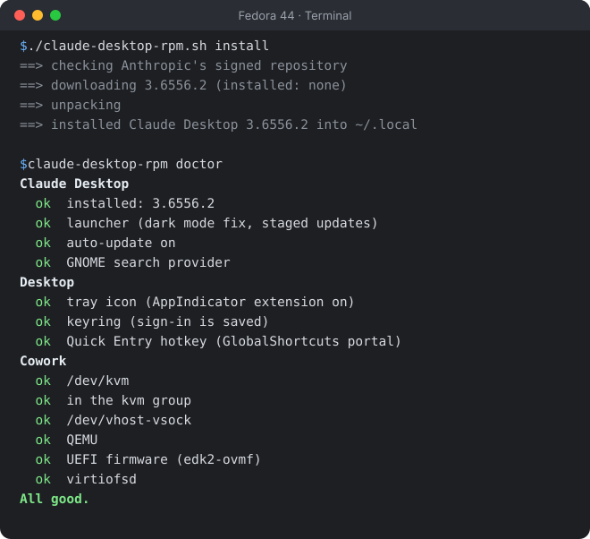
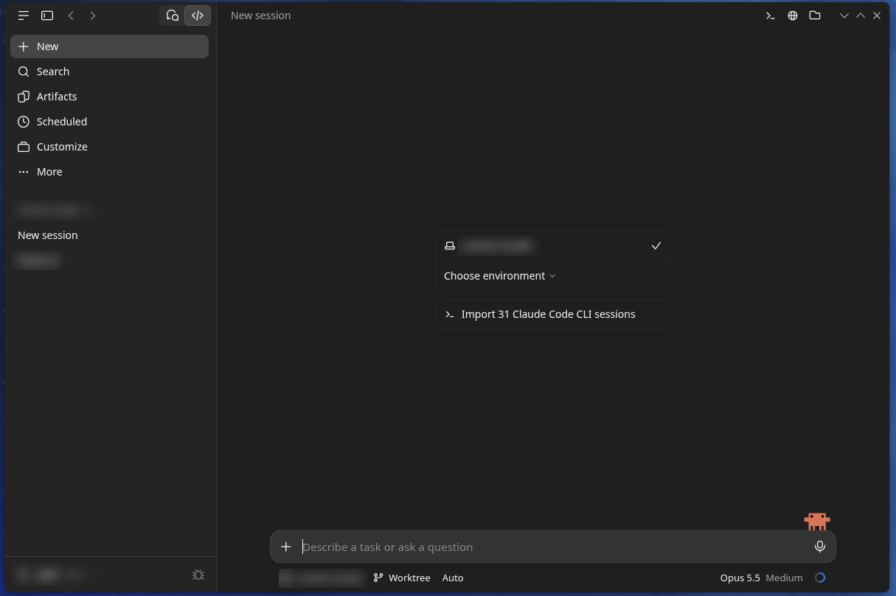

<div align="center">


# claude-desktop-rpm

**Anthropic's official Claude Desktop on Fedora: verified, unmodified, and kept up to date.**

[](https://github.com/ajithakdev/claude-desktop-rpm/actions/workflows/ci.yml)
[](https://github.com/ajithakdev/claude-desktop-rpm/releases/latest)
[](https://github.com/ajithakdev/claude-desktop-rpm/stargazers)
[](https://github.com/ajithakdev/claude-desktop-rpm/releases)
[](https://fedoraproject.org)
[](LICENSE)

[Install](#install) · [Commands](#commands) · [What it changes](#what-it-changes-on-your-system) · [Why this one](#why-this-one) · [FAQ](#faq) · [Guide](RESOURCES-AND-GUIDE.md)

</div>

Anthropic ships Claude Desktop for Linux only as a `.deb` for Ubuntu and Debian. This Bash script downloads that package from Anthropic, checks its signature and checksums, and installs it into your home folder without root. It also fixes what breaks on Fedora out of the box: dark mode, Cowork, the tray icon, GNOME search and updates.

Claude Desktop is Anthropic's proprietary app. Chat works on every plan, including Free; Claude Code and Cowork need a paid plan (Pro, Max, Team or Enterprise). Details are in Anthropic's [download FAQ](https://claude.com/download) and [plan table](https://support.claude.com/en/articles/10065433-install-claude-desktop). This script is MIT licensed, isn't made by Anthropic, and doesn't redistribute any of its files.

<p align="center">
  
</p>

## Install

```bash
sudo dnf install curl gnupg2 binutils tar
curl -fLO https://github.com/ajithakdev/claude-desktop-rpm/releases/latest/download/claude-desktop-rpm.sh
chmod +x claude-desktop-rpm.sh && ./claude-desktop-rpm.sh install
```

Open **Claude** from the app menu and sign in. If anything looks off, `claude-desktop-rpm doctor` checks the setup and prints the fix. For Cowork, run `claude-desktop-rpm cowork` once, then log out and back in.

<details>
<summary>Screenshot</summary>

<p align="center"></p>

</details>

## Commands

| Command | What it does |
| --- | --- |
| `install`, `update` | Install the newest version. Does nothing if you're current. |
| `update --force` | Reinstall the current version. |
| `auto-update on`, `off` | Turn the daily update check on or off. No argument shows its state. |
| `doctor` | Check everything and print fixes. |
| `cowork` | Set up Cowork (uses sudo). |
| `version` | Print the installed version. |
| `uninstall` | Remove everything it added. Chats and sign-in stay. |

## What it changes on your system

| Area | What happens |
| --- | --- |
| Files | Only `~/.local` and `~/.config`; every path is in the [guide](RESOURCES-AND-GUIDE.md#files-it-writes). `uninstall` removes them and rebuilds the menu, file-type and icon caches. Your chats and sign-in in `~/.config/Claude` stay. |
| Network | The script only talks to `downloads.claude.ai`. The app itself talks to Anthropic's servers, as on every platform. |
| Root | `install`, `update` and `uninstall` never use sudo. `cowork` does, to install `qemu-system-x86-core`, `edk2-ovmf` and `virtiofsd` from Fedora's repos, write `/etc/modules-load.d/vhost_vsock.conf`, load `vhost_vsock` and add you to the `kvm` group. It never changes a file a package owns, so `rpm -V` stays clean. |
| Updates | A systemd user timer checks once a day. If Claude is open, the verified update waits and goes in the next time you start it. `auto-update off` stops it. |
| Tested | `tests/sandbox.sh` checks all of this in a fresh Fedora 44 container on every pull request. |

## Why this one

Before installing anything, the script checks Anthropic's key fingerprint, that the repository index is signed by that key and hasn't expired, and the checksums of the package list and the `.deb`. It stops on any mismatch ([SECURITY.md](SECURITY.md) has the details).

| | claude-desktop-rpm | Third-party dnf repos | Build-your-own RPM scripts |
| --- | --- | --- | --- |
| Who you trust | Anthropic only | Anthropic and the repo owner's key | Anthropic and the build script |
| App files | Unmodified | Some patch the app | Unmodified or patched |
| Needs root to install | No | Yes | Yes |
| Updates | Daily, automatic | With `dnf upgrade` | Re-run the build |

Pick this one if you want Anthropic's exact build with no extra signing key on your system. Other good options: [claude-desktop-debian](https://github.com/aaddrick/claude-desktop-debian) (APT and DNF repos), [claude-desktop-fedora](https://github.com/dewzor/claude-desktop-fedora) (native RPM with Copr updates) and [claude-desktop-linux-flake](https://github.com/k3d3/claude-desktop-linux-flake) (Nix).

## FAQ

**Is this official?**
No. The app is Anthropic's official Linux build; the installer is a community project, not affiliated with Anthropic. Anthropic supports only Debian and Ubuntu for now and [says other distributions are coming](https://code.claude.com/docs/en/desktop-linux).

**Why isn't it an `.rpm` file?**
An RPM would need root to install and a signing key you'd have to trust. Unpacking Anthropic's package into your home folder avoids both. The name says what it's for: RPM-based systems.

**What doesn't work?**
Computer Use and dictation, which Anthropic's Linux build doesn't have yet on any distribution. Only Fedora 44 GNOME on x86_64 is tested; KDE, RHEL, Rocky and Alma probably work, and reports are welcome.

**Something looks wrong.**
Run `claude-desktop-rpm doctor`. The [guide](RESOURCES-AND-GUIDE.md#when-something-goes-wrong) covers the rest, such as the app's "Update available" button, a light System theme, or "Hardware acceleration disabled" after a reboot.

## Stars and downloads

<a href="https://github.com/ajithakdev/claude-desktop-rpm/releases">
  <picture>
    <source media="(prefers-color-scheme: dark)" srcset="https://raw.githubusercontent.com/ajithakdev/claude-desktop-rpm/stats/stats-dark.svg" />
    
  </picture>
</a>

Downloads count the script itself, per release; GitHub doesn't keep a daily history. Updates come from Anthropic's repository, not this script, so this is close to the number of installs. The card is redrawn daily.

## Contributing

Bug reports, test reports from other desktops and fixes are welcome. [CONTRIBUTING](.github/CONTRIBUTING.md) has the setup and the four test scripts, and there are [good first issues](https://github.com/ajithakdev/claude-desktop-rpm/labels/good%20first%20issue). Questions go to [Discussions](https://github.com/ajithakdev/claude-desktop-rpm/discussions).

## Credits

Maintained by [ajithakdev](https://github.com/ajithakdev). Written with help from Claude, Anthropic's AI assistant, which drafted much of the script, tests and docs; every change is reviewed and tested before release. Thanks to Marko Jokinen for the signature-check report in [#7](https://github.com/ajithakdev/claude-desktop-rpm/issues/7), and to Fedora Magazine editors Gregory Lee Bartholomew, Richard England and Justin Wheeler, whose [review](https://discussion.fedoraproject.org/t/205949) led to [#8](https://github.com/ajithakdev/claude-desktop-rpm/issues/8) and [#9](https://github.com/ajithakdev/claude-desktop-rpm/issues/9).

## License

MIT for the script. Claude Desktop is Anthropic's software under [Anthropic's terms](https://www.anthropic.com/legal/consumer-terms). Not affiliated with or endorsed by Anthropic.
